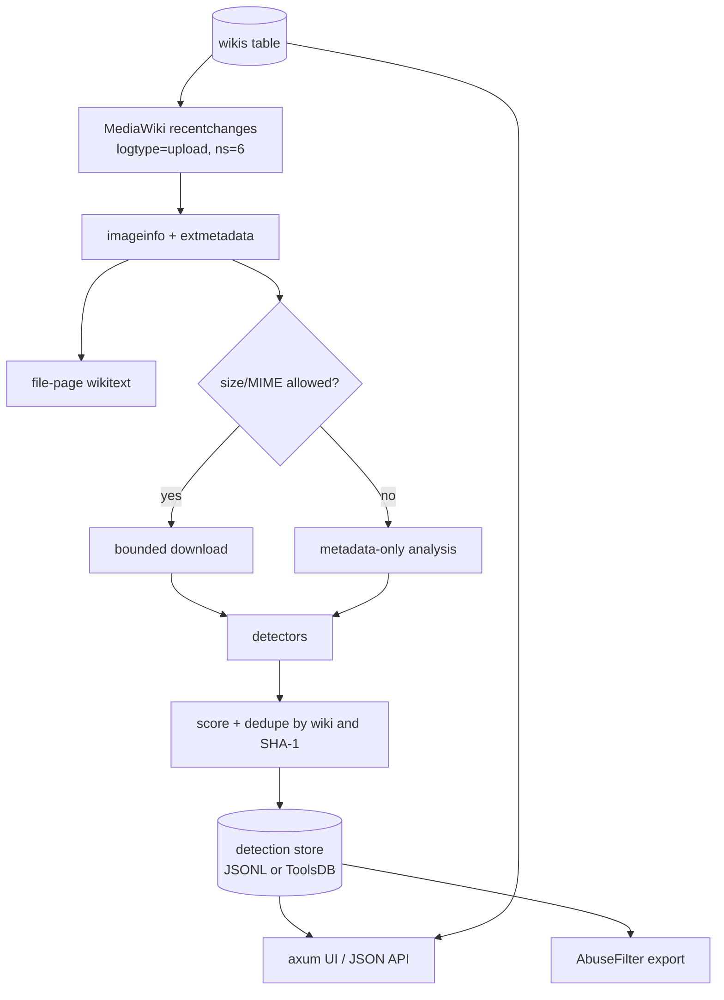

# fAIke

A watchdog for files uploaded to MediaWiki sites. It watches Wikimedia
Commons, English Wikipedia and German Wikipedia by default, and can watch any
further wiki added to its `wikis` table. It inspects upload metadata and
provenance signals for evidence that a file was created or edited with
generative AI, stores detections, serves a small browsing UI, and emits rules
that can be pasted into MediaWiki `AbuseFilter`.

The design is deliberately evidence-based: every detection carries its source
and confidence, and the UI never presents a score as proof.

## Quick start

```bash
cp config.json.template config.json
# Edit user_agent and, for local use, leave web_address at 127.0.0.1.
scripts/fetch-models.sh models   # optional but recommended; 62 MB of TrustMark models
cargo run --release -- run config.json
# Browse http://127.0.0.1:8000/
```

`run` starts the watcher and the web server in one process. `watch` runs only the
watcher (for a bot process), and `serve` serves the UI from an existing store and
reloads it every five seconds. Detections go to the configured `store`: a local
JSONL file (single writer) or the tool's ToolsDB database (shared by the bot and
the web service). The wiki list lives in the same store and can be changed
without a restart.

Analyse a local file without the watcher:

```bash
cargo run --release -- scan path/to/file.png
```

The `scan` output is JSON with one `Signal` per piece of evidence, plus an
aggregate score and level. `corpus` evaluates a whole index; see the benchmark
section below.

## What it detects

| Source | Examples | Typical confidence |
| --- | --- | --- |
| C2PA / Content Credentials | `digitalSourceType` `trainedAlgorithmicMedia`, `compositeWithTrainedAlgorithmicMedia`, AI `claim_generator`/`softwareAgent` | High (Medium if the manifest is invalid/unsigned) |
| IPTC XMP | `Iptc4xmpExt:DigitalSourceType`, `AISystemUsed`, `AISystemVersionUsed`, `AIPromptInformation` | High |
| XMP / EXIF software fields | `xmp:CreatorTool`, `tiff:Software`, `Software`, `Make`, `Model`, `ImageDescription`, `UserComment` | Medium |
| PNG text chunks | A1111 `parameters`, ComfyUI `prompt`/`workflow`, `Software`, `Comment`, `Raw profile type xmp` | High for prompt payloads, Medium for text |
| Container fallback | AI source-type/AI-system strings in malformed or unusual containers; SVG metadata | High for explicit source types, lower for text |
| Stable Diffusion DWT-DCT watermark | `StableDiffusionV1` (136 bits), `SDV1`/`SDXL` (32 bits), unknown-periodicity marks | High for a known payload, Medium for an unknown stable mark |
| Adobe TrustMark | decoder payload with the configured BCH schema | Medium (provenance, not necessarily AI) |
| ONNX AI-image classifier | two independently trained models (Swin + Community Forensics ViT); flags stripped files when both agree | Medium; probabilistic, weak on charts/diagrams |
| Generator-size heuristic | exact common output sizes (1024×1024, 1536×768, …) with no camera/software metadata or PNG text | Low |
| Wikimedia `extmetadata` | `Software`, `ImageDescription`, `Credit`, `Artist`, `Categories` | Medium to High for `Software` |
| File-page wikitext | `{{PD-algorithm}}`, `{{AI-generated}}`, `{{Created with Midjourney}}`, AI categories | High |
| Upload comment | vendor names, explicit "AI-generated" statements | Low |

Scores are bands: Low 30, Medium 60, High 90. Each additional distinct source at
Medium or above adds a 5-point corroboration bonus, capped at 99. The default
`min_score` is 30, so a weak comment-only hit is still visible for review.

Deliberately **not** implemented yet:

- Google SynthID image detection (not open source), Meta Stable Signature /
  VideoSeal, and other model-based watermark schemes.
- Visible watermark/logo detection or OCR.
- AI-generated charts/diagrams: the pixel classifier sees these as human-made
  (their layout/text dominates), and stripped charts have no provenance.
- Video/audio frame analysis. Video/audio uploads still get metadata and
  description analysis; only `image/*` is downloaded by default.

These are roadmap items, not silent gaps. See the crate survey below.

## Architecture



- `src/mediawiki.rs` — Action API client, cursor, `imageinfo`, wikitext, bounded
  downloads, retries for 429/5xx/`maxlag`, invalid-JSON/rate-limit pages.
- `src/wiki.rs` — the `Wiki` model and the Commons/enwiki/dewiki defaults.
- `src/watcher.rs` — polls every enabled wiki, batching, dedupe, concurrent
  download/analysis.
- `src/detect/` — independent detectors: `c2pa`, `xmp`, `exif`, `png`,
  `container`, `fingerprint`, `classifier`, `description`, and `watermark`
  (`dwt_dct`, `trustmark`).
- `src/patterns.rs` — single source of truth for vendor names, prompt markers,
  AI phrases, wikitext templates, and the AbuseFilter regexes.
- `src/store/` — `Store` dispatches between the JSONL backend (`file.rs`) and
  the ToolsDB backend (`toolsdb.rs`); both share the in-memory ring in `mod.rs`.
- `src/telemetry.rs` — `wikimisc` metrics for the bot and the web service.
- `src/web.rs` — server-rendered UI, `/api/detections`, `/api/status`,
  `/api/wikis`, `/abuse-filters`, `/abuse-filters.json`, `/healthz`.
- `src/abuse_filter.rs` — generates paste-ready rules.

The process runs the watcher and web server together. On Toolforge, `Procfile`
runs them as separate processes. With ToolsDB both read the same database: the
bot writes to the primary, `serve` reads the replica and reloads every five
seconds. SQLite-style single-writer caveats do not apply.

## Wikis

The `wikis` table is the live list. The bot reads it every poll, the web service
every five seconds, so changes need no restart:

```sql
-- add a wiki (the API endpoint must be https)
INSERT INTO wikis (domain, display_name, api_url, sort_order)
VALUES ('fr.wikipedia.org', 'French Wikipedia',
        'https://fr.wikipedia.org/w/api.php', 3);

-- stop polling it but keep its detections and cursor
UPDATE wikis SET enabled = 0 WHERE domain = 'de.wikipedia.org';

-- disable and remove it
DELETE FROM wikis WHERE domain = 'de.wikipedia.org';
```

`namespace` defaults to 6 (File). The cursor columns are maintained by the bot.
On first start the table is seeded with Commons, English Wikipedia and German
Wikipedia; a `meta` flag prevents them from reappearing after a deliberate
delete. The file backend keeps the same list, with the cursors, in `wikis.json`.

The web UI defaults to Commons. `/?wiki=en.wikipedia.org` is a linkable view per
wiki, `/?wiki=all` shows every wiki, and each row links to its wiki. The same
`wiki` parameter filters `/api/detections` and `/abuse-filters`; `/api/wikis`
lists the configured wikis.

## AbuseFilter output

`GET /abuse-filters` returns plain text; `GET /abuse-filters.json` returns the
same rules as JSON. There are two kinds of rule:

1. **Upload description/summary rules** for vendor names, prompt parameters,
   AI templates/categories, and explicit AI statements. These use
   `action == "upload"`, `page_namespace == 6`, and `added_lines`/`summary`.
   `added_lines` is available for uploads (MediaWiki 1.28+).
2. **Exact SHA-1 rules** for files this tool scored at or above
   `abuse_filter_min_score`. These use
   `equals_to_any(file_sha1, ...)` for both `upload` and `stashupload`.

Important limitations, by design:

- AbuseFilter cannot inspect embedded EXIF/XMP/C2PA. It only sees the upload
  wikitext, summary, and `file_*` variables. A file with rich AI metadata but a
  bland description will not match a description rule.
- Exact SHA-1 matching only catches byte-identical files. Re-encoding, resizing,
  or editing changes the hash. SHA-1 lists are therefore a supplement, not the
  primary control.
- Metadata can be stripped. Absence of metadata is not evidence of human
  authorship.
- Generated rules suggest `warn`/`tag`, **not** `disallow`. Review before
  blocking; a photograph can be AI-edited, and a file can mention an AI tool
  without being generated by it.

`file_sha1` in AbuseFilter is hexadecimal, matching `imageinfo`'s `sha1`
property (see Wikimedia T200942); the upload log's `img_sha1` is base-36 and is
not used for the rules.

### How AbuseFilter can access these results

AbuseFilter is evaluated inside MediaWiki and cannot make HTTP calls, read the
ToolsDB database, or consume a JSON feed. What it can see for an upload is the
description/summary (`added_lines`, `summary`) and the file variables
(`file_sha1`, `file_mime`, `file_size`, ...). So there is no way to give it a
live lookup; the result has to be copied into the filter itself, or into
wikitext that the filter matches. In practice:

1. **Static export (available now).** Open
   `/abuse-filters?wiki=commons.wikimedia.org`, review the rules, and paste them
   into `Special:AbuseFilter`. Repeat when the list should be refreshed. This is
   the simplest and fully supported path.
2. **A bot-maintained SHA-1 filter.** A bot with the `abusefilter-modify` right
   can periodically replace the `equals_to_any(file_sha1, ...)` part of one
   filter with a fresh, short list from `/abuse-filters.json`. The filter still
   evaluates locally; only the expression is updated. Keep the list small and
   rotate it, because filter expressions have size limits.
3. **Tag or template, then match that.** The bot can add a change tag to the
   upload, or edit the file page to add a maintenance template/category. Later
   edits can be matched with `added_lines`/`new_wikitext`, and queries/reports
   can use the tag or category. This is asynchronous and does not stop the
   original upload, but it is the only way to attach a per-file verdict without
   hard-coding the bytes.
4. **A list page for humans and other bots.** Publish the detections (or the
   SHA-1 list) on an on-wiki page. AbuseFilter still cannot read it, but
   reviewers, patrolling tools, and other bots can.

A real live lookup would need a new AbuseFilter variable or parser function
provided by a MediaWiki extension, which Wikimedia wikis do not have. The
`warn`/`tag` actions are deliberate: metadata and watermarks are evidence, not
proof, and blocking on them would create false positives that are hard to
appeal.

## Rust crate survey

Used:

| Crate | License | Role |
| --- | --- | --- |
| `c2pa` | MIT/Apache-2.0 | Reference C2PA reader, with `rust_native_crypto` to avoid OpenSSL |
| `nom-exif` | MIT | Pure-Rust EXIF/TIFF/PNG/WebP/HEIF parsing |
| `roxmltree` | MIT/Apache-2.0 | Read-only XMP XML parsing |
| `miniz_oxide` | MIT/Apache-2.0 | `zTXt` inflation with an output cap |
| `aho-corasick`, `regex` | MIT/Apache-2.0 | Vendor/prompt/wikitext matching |
| `image` | MIT/Apache-2.0 | Pixel decoding for watermark analysis |
| `trustmark` + `ort` | MIT / MIT OR Apache-2.0 | Adobe TrustMark ONNX decoder; ONNX Runtime is statically linked at build time |
| `reqwest`, `axum`, `tokio` | MIT/Apache-2.0 | HTTP client, web server, runtime |

Considered but not used:

| Crate / project | License | Why |
| --- | --- | --- |
| `aicheck` | AGPL-3.0-or-later | Closest end-to-end prior art (C2PA, XMP/IPTC, EXIF, PNG text, heuristic watermarks). Its AGPL license and heavy dependency set (including the C2PA SDK, `image`, `rustfft`, i18n) made it unsuitable to link into this tool. The vendor/signal ideas informed this implementation. |
| `exif-oxide` | AGPL-3.0-or-later | Ambitious ExifTool reimplementation; AGPL. `nom-exif` covers the fields we need. |
| `encypher-c2pa` | Apache-2.0 | Verification-only offline C2PA SDK; a lighter alternative to `c2pa`, but less established. |
| `provcheck` suite | Apache-2.0 | C2PA verification plus TrustMark/SilentCipher/SynthID-text watermark detectors. Some neural detectors are commercial/DLC; worth evaluating for additional watermark schemes. |
| `invisible-watermark` (crates.io) | MIT | Implements a *different* LSB/DWT scheme. It is **not** the Stable Diffusion `invisible-watermark` Python library's `dwtDct` payload, so it cannot detect those marks. |
| `img-parts` | MIT/Apache-2.0 | Container chunk/segment reader. Rejects bad CRCs, while this tool deliberately parses tolerantly; a good replacement if strict parsing is acceptable. |
| `kamadak-exif` | BSD-2-Clause | Mature EXIF parser; `nom-exif` additionally gives PNG text and video containers. |
| `gamut-metadata` | MIT/Apache-2.0 | Unified EXIF/XMP/IPTC facade; newer, and `nom-exif` + `roxmltree` was sufficient. |
| `little_exif` | MIT | Read/write EXIF; writing is not needed. |
| `mediawiki` | MIT/Apache-2.0 | Action API builders; this tool needs `loginfo`, `extmetadata`, a custom cursor, and retry behaviour, so it uses a small direct client inspired by `wdrc_rs`. |
| `wikimisc` | (git, project license) | Telemetry/metrics for the bot and web service. |
| `toolforge` | MIT/Apache-2.0 | ToolsDB pools, credential lookup and `toolforge-tunnel`; used by the ToolsDB store. |

Other-language/ecosystem options worth translating or wrapping:

- **Stable Diffusion `invisible-watermark`** (Python, ShieldMnt, MIT): the
  `dwtDct` decoder is implemented here from the published algorithm. It is
  fragile: a PNG with a correctly embedded payload decodes cleanly, while a
  JPEG-recompressed copy often does not (4:2:0 chroma subsampling and
  quantization remove the weak U/V signal). The reference Python decoder fails
  the same way, so this is a property of the scheme, not of the port. `rivaGan`
  is not implemented.
- **Meta Stable Signature / VideoSeal** (PyTorch): model-based watermark
  detection; possible via `ort` / `candle`, after model conversion.
- **Google SynthID**: the text watermark has public implementations
  (`provcheck-synthid-text`); the image detector is not open source and is
  available through Google's cloud tooling. Do not claim image SynthID support
  without that dependency.
- **AI-image classifiers** (e.g. ViT models such as
  `umm-maybe/AI-image-detector`, `Organika/sdxl-detector`) via `ort`/`candle`.
  Treat as probabilistic, biased, and weaker than provenance; never use alone
  for blocking.
- **OCR for visible watermarks** (Tesseract bindings, `ocrs`/`rten`): future,
  and best combined with vendor-logo templates rather than free-text OCR.

## Watermark calibration

Pixel watermarks always need calibration. `faike calibrate <files...>` prints, for
each image, the DWT-DCT candidates (length, bit-stability margin, fraction of
coefficients near the encoder's quantization centers, and known-payload match)
and the TrustMark decoder result. It uses `config.json` or `FAIKE_CONFIG` for
model paths and thresholds.

Defaults were calibrated on a small local corpus (PNG and JPEG maps, photos,
noise, gradients, a C2PA sample, and Python `invisible-watermark` encodes), on
76 files from the Commons `AI-generated_media` subcategories, and on 68 ordinary
images as a negative control:

- `dwt_match_threshold = 0.85`: genuine `StableDiffusionV1`/`SDV1` PNG encodes
  matched 97–100% of payload bits; ordinary images matched ~0.5–0.63.
- `dwt_margin_threshold = 0.35`: genuine PNG encodes were 0.46–0.93; ordinary
  images were 0.03–0.45.
- `dwt_generic_margin_threshold = 0.90`: an unknown-periodicity mark is weak
  evidence, and periodic screenshots/photos can look stable. Two negatives had
  margins of 0.82 and 0.87; 0.90 removes them, and no known-positive relies on
  the generic signal.
- `dwt_lock_threshold = 0.60`: genuine encodes were 0.66–0.84; ordinary images
  were ~0.45. This guard is essential: a constant or JPEG-flattened image
  produces unanimous zero bits (margin 1.0) without any watermark.
- `classifier.primary.threshold = 0.95`: with the primary model alone, all 35
  classifier hits on the positive corpus were at least 97%, while the weakest
  hit on the ordinary negative set was 83%. Lowering it adds false positives
  without gaining corpus recall. `classifier.secondary.threshold = 0.65`: the secondary model is
  a single-logit model, and its score is on a different calibration. Requiring
  both models to cross their thresholds removes most confident false calls; the
  counts are stable for any secondary threshold in 0.50–0.70, so 0.65 is not a
  knife-edge.

The reference `invisible-watermark` encoder only marks the U channel (its
`scales` list suggests U and V, but the loop covers channels 0–1), and OpenCV
rounds YUV to 8 bits before the DWT. The Rust decoder matches both details;
scanning V as well, or keeping fractional U values, diluted or shifted the bit
votes.

Known limitations:

- DWT-DCT survives PNG but often not JPEG re-encoding, resizing, or screenshot
  round-trips. The reference Python decoder has the same limitation.
- The current decoder accepts only the configured TrustMark BCH schema. The Rust
  crate falls back to other schemas, which turns random payloads into BCH3
  codewords; a 75-bit fallback while configured for BCH5 is ignored. This is
  deliberate false-positive control, not a decoder failure.
- A TrustMark mark is provenance evidence, not automatically AI evidence.
- Images below 256×256 are skipped by DWT-DCT; images above 24 megapixels are
  not decoded for pixel analysis.

## Configuration and operation

See `config.json.template`. Key points:

- `user_agent` is mandatory and must identify you with a URL or e-mail.
  Wikimedia's User-Agent policy applies.
- `backfill_events` analyses that many recent uploads on first start **per
  wiki** (default 50). `0` starts at the current time.
- `download_mime_prefixes` defaults to `["image/"]`; files outside it still get
  metadata/wikitext analysis.
- `max_download_bytes` bounds memory and bandwidth; oversized files are
  metadata-only.
- `store` selects where detections go. `kind: "file"` uses `file` and
  `wikis_file`, which must be on persistent storage on Toolforge. `kind:
  "toolsdb"` uses the tool's database: an empty `database` derives
  `<tool user>__faike_p`. `replica_my_cnf` is left `null` on Toolforge, where the
  `toolforge` crate finds the credentials itself; locally point it at a copy with
  `local = 'true'` and run `toolforge-tunnel`. `pool_max`, `connect_timeout_sec`
  and `max_statement_time_sec` follow the Toolforge connection policy.
- Watermark analysis is controlled by `detect.watermark`. `models_dir` points at
  the directory populated by `scripts/fetch-models.sh`; on Toolforge use a
  persistent path such as `/data/project/faike/models`. TrustMark is disabled
  cleanly if the models are absent. The ONNX Runtime is statically linked, so
  no separate shared library is needed at runtime, but builds are larger and
  slower.
- `detect.classifier` is the optional AI-image classifier. Run
  `scripts/fetch-classifier.sh models` once (about 180 MB); if a model is
  missing, that model is skipped. The primary model's fields stay flat for
  compatibility (`model_path`, `input_size`, `ai_label`, `threshold`); the
  optional `secondary` object configures a second, independently trained model,
  and `require_agreement` (default `true`) requires both to cross their own
  thresholds. If the secondary is configured but missing, `require_agreement`
  suppresses the classifier rather than silently falling back to one model.
  Each model has its own preprocessing: `resize_shortest` (resize the shortest
  edge, then centre crop) and `normalization` (`imagenet` or `clip`). The
  classifier runs only when the structured detectors found nothing, and skips
  tiny images and extreme aspect ratios. Both models are downloaded, not
  redistributed: the primary (`SMOGY/SMOGY-Ai-images-detector`, converted by
  `onnx-community`) is CC-BY-NC-4.0; the secondary (`fev`/Community Forensics
  ViT-S/16) is MIT.
- `detect.fingerprint` is the low-confidence exact-size heuristic. It is on by
  default; set it to `false` to suppress its 30-point signals.
- `DASHBOARD_TOKEN` enables `wikimisc` telemetry (component `bot` or `web`);
  without it the service runs normally. Metrics include polls, uploads,
  analysed files, detections per wiki, store errors, and analysis duration.
- The default `web_address` is loopback. Set `0.0.0.0` (or use
  `$FAIKE_ADDRESS`) on Toolforge; `$FAIKE_PORT` overrides the port.
- The watcher is polite: one recent-changes poll at a time, batched imageinfo
  and wikitext requests, two concurrent downloads by default, `maxlag=5`, and
  retries with `Retry-After` on 429/5xx.

Security/privacy: the tool only reads public data, never authenticates, and does
not store IP addresses or e-mail addresses. The web UI escapes all dynamic
content, rejects non-http(s) links, and sets a restrictive CSP,
`X-Content-Type-Options`, `X-Frame-Options`, `Referrer-Policy`, `noindex`, and
`Cache-Control: no-store`.

## Testing

```bash
cargo test
cargo clippy --all-targets -- -D warnings
cargo fmt --check
```

Tests cover the detector parsers with synthetic PNG/XMP/EXIF data, scoring,
watermark DWT-DCT round-trips (including JPEG/constant-image false-positive
guards), the optional TrustMark and classifier round-trips when models are
present, the generator-size heuristic, AbuseFilter escaping/chunking, both store
backends and read-only reload, the recent-changes parser, and the web routes
(including HTML escaping). `FAIKE_DEBUG=1` prints per-detector timings and
per-file progress.

`tests/corpus.rs` runs the built binary over seven permanent fixtures in
`tests/fixtures/`: five unmodified Commons AI-media uploads (C2PA, XMP and EXIF
signals), one ordinary photo as a negative control, and one synthetic
`invisible-watermark` PNG. Attribution and licences are in
`tests/fixtures/README.md`.

### Evaluating detection rates

`faike corpus <index.json> [--bytes-only]` evaluates an index of
`{title: {path, extmetadata, wikitext?, comment?}}`. `--bytes-only` drops the
MediaWiki metadata, which simulates an upload whose page does not declare AI;
without it, the full watcher path is measured. Output is JSONL per file, with a
summary on stderr.

On the 2026-11 Commons snapshot (76 files, all declared AI):

| Run | Flagged | Notes |
| --- | --- | --- |
| Full metadata | 76/76 | the description detector catches categories/templates |
| Bytes only, before the classifier | 25/76 | C2PA/XMP/PNG text/EXIF only |
| Bytes only, primary classifier | 62/76 (82%) | adds 35 classifier and 1 generator-size signal |
| Bytes only, two-model agreement | 59/76 (78%) | 32 classifier signals; the secondary model rejects three clear AI images |

The 17 byte-only misses are almost all LLM-generated charts and diagrams: the
classifier confidently considers them human-made, and no watermark survives.
That is a known limitation, not a tuning problem. The three images lost to
agreement are two AI cat photos and a Dall-E/Stable Diffusion comparison chart,
which the secondary model scores as human-made.

The hard-negative control is deliberately adversarial for the classifier: 182
images from Featured pictures, Quality images, Diagrams, Screenshots,
Photographs, portrait photographs, historical photographs, paintings and digital
art. It contains scans, retouched photos and 3D renders.

| Run | Flagged | Classifier signals |
| --- | --- | --- |
| Primary classifier | 30/182 | 21 |
| Two-model agreement | 15/182 | 6 |

The agreement rule cuts classifier false positives by 71% for three true
positives. The six remaining classifier hits are mostly label noise in the
negative set: a NARA portrait that both models call artificial, an AI-upscaled
portrait, and two Mandelbulb 3D renders. The other hits on negatives come from
C2PA/XMP/PNG text that genuinely declares AI or AI-upscaled provenance. A plain
negative control of 68 ordinary images gives 4 classifier flags with the primary
model and 1 with agreement.

The fingerprint heuristic, the aspect-ratio guard, and the DWT generic threshold
were tuned on these sets. Provenance gates that skipped images with camera or
editing EXIF and PNG text were evaluated and removed: combined with two-model
agreement they cost two true positives and saved only one false positive.

The ToolsDB round-trip is opt-in because it needs the tunnel and credentials:

```bash
FAIKE_TOOLSDB_TEST=1 cargo test -- --ignored
```

To reproduce the benchmark locally (the downloads stay out of the repository):

```bash
scripts/fetch-corpus.py --out /tmp/ai --per-category 20
scripts/fetch-corpus.py --out /tmp/neg --per-category 15 \
    --category "Featured pictures on Wikimedia Commons" \
    --category "Quality images" --category "Diagrams" \
    --category "Screenshots" --category "Photographs"
scripts/fetch-classifier.sh models          # optional, ~180 MB
cargo run --release -- corpus /tmp/ai/index.json --bytes-only
cargo run --release -- corpus /tmp/neg/index.json
```

## Toolforge deployment

`Procfile` assumes the Toolforge tool account is `faike` and the config is at
`/data/project/faike/config.json`:

```procfile
web: FAIKE_ADDRESS=0.0.0.0 FAIKE_PORT=$PORT ./target/release/faike serve /data/project/faike/config.json
bot: RUST_LOG=warn,nom_exif=error ./target/release/faike watch /data/project/faike/config.json
```

Prepare the persistent paths once on the tool account:

```bash
mkdir -p /data/project/faike/models
scripts/fetch-models.sh /data/project/faike/models
scripts/fetch-classifier.sh /data/project/faike/models
# In /data/project/faike/config.json:
#   "web_address": "0.0.0.0"
#   "store": {"kind": "toolsdb", "database": "s58339__faike_p"}
#   "detect": {
#     "watermark": {"models_dir": "/data/project/faike/models"},
#     "classifier": {
#       "model_path": "/data/project/faike/models/ai-image-detector.onnx",
#       "secondary": {
#         "model_path": "/data/project/faike/models/ai-image-detector-commfor.onnx",
#         "input_size": 384, "ai_label": null, "threshold": 0.65,
#         "resize_shortest": 440, "normalization": "clip"
#       },
#       "require_agreement": true
#     }
#   }
```

The database (`s58339__faike_p`) and its tables are created on first start by
either process from `schema.sql` (embedded at build time), so a fresh deployment
needs no manual SQL. The tables are `wikis` (the live wiki list plus per-wiki
cursors), `detections` (one row per wiki/file, indexed by `timestamp`,
`(score, timestamp)`, `sha1` and `(wiki, timestamp)`), and `meta` (seed flags).

Build and deploy with the build service:

```bash
./build.sh                 # toolforge build start https://github.com/magnusmanske/faike/
./webservice.sh start      # web service from the Procfile `web` entry
./restart.sh               # bot job from the Procfile `bot` entry
```

`webservice.sh restart` is the usual command after a rebuild. The `web` Procfile
entry binds `0.0.0.0` and takes the port from Toolforge. The web service reads
the ToolsDB replica and reloads every five seconds, so it does not compete with
the bot for the primary. The models and ONNX Runtime are large, so the build and
image are larger than a metadata-only deployment.

The bot job needs **2 GiB**, not 1 GiB: pixel analysis keeps several
full-resolution planes alive, and one 24 MP image peaks around 540 MB. With
two concurrent downloads (the default), a 1 GiB limit is OOM-killed as soon as
a batch contains two large photos, and the cursor makes it retry the same batch
in a crash loop. `restart.sh` therefore requests `--mem 2Gi`; the tool quota
allows up to 6 GiB per job.

If the build service cannot download the ONNX Runtime binaries used by
`trustmark` and the classifier, build with
`--no-default-features --features toolsdb,telemetry`; the DWT-DCT detector then
still works and both ONNX detectors are skipped.

## Roadmap

1. Additional watermark decoders: Stable Signature/VideoSeal, SynthID where an
   API/credential is available, and additional TrustMark schemas.
2. Visible watermark/logo and OCR signals, plus a "vendor badge" detector.
3. A classifier or VLM for AI-generated charts and diagrams, the dominant
   remaining byte-only miss; keep it probabilistic and never use it for
   `disallow`.
4. Video/audio: sample frames/audio, reuse the image/watermark detectors.
5. An on-wiki bot mode that tags/notifies, and a public report page.
6. C2PA trust-list validation and trust-state display (currently only
   cryptographic validity is reported; no trust anchors are configured).
