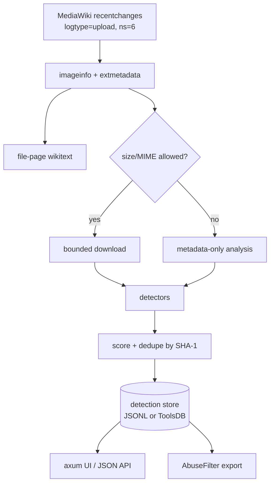

# aimer

A watchdog for files uploaded to MediaWiki sites, starting with Wikimedia
Commons. It inspects upload metadata and provenance signals for evidence that a
file was created or edited with generative AI, stores detections, serves a small
browsing UI, and emits rules that can be pasted into MediaWiki `AbuseFilter`.

The design is deliberately evidence-based: every detection carries its source
and confidence, and the UI never presents a score as proof.

## Quick start

```bash
cp config.json.template config.json
# Edit user_agent and, for local use, leave web_address at 127.0.0.1.
scripts/fetch-models.sh models   # optional but recommended; 62 MB of TrustMark models
cargo run --release -- run config.json
# Browse http://127.0.0.1:8000/
```

`run` starts the watcher and the web server in one process. `watch` runs only the
watcher (for a bot process), and `serve` serves the UI from an existing store and
reloads it every five seconds. Detections go to the configured `store`: a local
JSONL file (single writer) or the tool's ToolsDB database (shared by the bot and
the web service).

Analyse a local file without the watcher:

```bash
cargo run --release -- scan path/to/file.png
```

The `scan` output is JSON with one `Signal` per piece of evidence, plus an
aggregate score and level.

## What it detects

| Source | Examples | Typical confidence |
| --- | --- | --- |
| C2PA / Content Credentials | `digitalSourceType` `trainedAlgorithmicMedia`, `compositeWithTrainedAlgorithmicMedia`, AI `claim_generator`/`softwareAgent` | High (Medium if the manifest is invalid/unsigned) |
| IPTC XMP | `Iptc4xmpExt:DigitalSourceType`, `AISystemUsed`, `AISystemVersionUsed`, `AIPromptInformation` | High |
| XMP / EXIF software fields | `xmp:CreatorTool`, `tiff:Software`, `Software`, `Make`, `Model`, `ImageDescription`, `UserComment` | Medium |
| PNG text chunks | A1111 `parameters`, ComfyUI `prompt`/`workflow`, `Software`, `Comment`, `Raw profile type xmp` | High for prompt payloads, Medium for text |
| Container fallback | AI source-type/AI-system strings in malformed or unusual containers; SVG metadata | High for explicit source types, lower for text |
| Stable Diffusion DWT-DCT watermark | `StableDiffusionV1` (136 bits), `SDV1`/`SDXL` (32 bits), unknown-periodicity marks | High for a known payload, Medium for an unknown stable mark |
| Adobe TrustMark | decoder payload with the configured BCH schema | Medium (provenance, not necessarily AI) |
| Commons `extmetadata` | `Software`, `ImageDescription`, `Credit`, `Artist`, `Categories` | Medium to High for `Software` |
| File-page wikitext | `{{PD-algorithm}}`, `{{AI-generated}}`, `{{Created with Midjourney}}`, AI categories | High |
| Upload comment | vendor names, explicit "AI-generated" statements | Low |

Scores are bands: Low 30, Medium 60, High 90. Each additional distinct source at
Medium or above adds a 5-point corroboration bonus, capped at 99. The default
`min_score` is 30, so a weak comment-only hit is still visible for review.

Deliberately **not** implemented yet:

- Google SynthID image detection (not open source), Meta Stable Signature /
  VideoSeal, and other model-based watermark schemes.
- Visible watermark/logo detection or OCR.
- Neural-network "is this AI?" classifiers.
- Video/audio frame analysis. Video/audio uploads still get metadata and
  description analysis; only `image/*` is downloaded by default.

These are roadmap items, not silent gaps. See the crate survey below.

## Architecture



- `src/mediawiki.rs` — Action API client, cursor, `imageinfo`, wikitext, bounded
  downloads, retries for 429/5xx/`maxlag`, invalid-JSON/rate-limit pages.
- `src/watcher.rs` — poll loop, batching, dedupe, concurrent download/analysis.
- `src/detect/` — independent detectors: `c2pa`, `xmp`, `exif`, `png`,
  `container`, `description`, and `watermark` (`dwt_dct`, `trustmark`).
- `src/patterns.rs` — single source of truth for vendor names, prompt markers,
  AI phrases, wikitext templates, and the AbuseFilter regexes.
- `src/store/` — `Store` dispatches between the JSONL backend (`file.rs`) and
  the ToolsDB backend (`toolsdb.rs`); both share the in-memory ring in `mod.rs`.
- `src/web.rs` — server-rendered UI, `/api/detections`, `/api/status`,
  `/abuse-filters`, `/abuse-filters.json`, `/healthz`.
- `src/abuse_filter.rs` — generates paste-ready rules.

The process runs the watcher and web server together. On Toolforge, `Procfile`
runs them as separate processes. With ToolsDB both read the same database: the
bot writes to the primary, `serve` reads the replica and reloads every five
seconds. SQLite-style single-writer caveats do not apply.

## AbuseFilter output

`GET /abuse-filters` returns plain text; `GET /abuse-filters.json` returns the
same rules as JSON. There are two kinds of rule:

1. **Upload description/summary rules** for vendor names, prompt parameters,
   AI templates/categories, and explicit AI statements. These use
   `action == "upload"`, `page_namespace == 6`, and `added_lines`/`summary`.
   `added_lines` is available for uploads (MediaWiki 1.28+).
2. **Exact SHA-1 rules** for files this tool scored at or above
   `abuse_filter_min_score`. These use
   `equals_to_any(file_sha1, ...)` for both `upload` and `stashupload`.

Important limitations, by design:

- AbuseFilter cannot inspect embedded EXIF/XMP/C2PA. It only sees the upload
  wikitext, summary, and `file_*` variables. A file with rich AI metadata but a
  bland description will not match a description rule.
- Exact SHA-1 matching only catches byte-identical files. Re-encoding, resizing,
  or editing changes the hash. SHA-1 lists are therefore a supplement, not the
  primary control.
- Metadata can be stripped. Absence of metadata is not evidence of human
  authorship.
- Generated rules suggest `warn`/`tag`, **not** `disallow`. Review before
  blocking; a photograph can be AI-edited, and a file can mention an AI tool
  without being generated by it.

`file_sha1` in AbuseFilter is hexadecimal, matching `imageinfo`'s `sha1`
property (see Wikimedia T200942); the upload log's `img_sha1` is base-36 and is
not used for the rules.

## Rust crate survey

Used:

| Crate | License | Role |
| --- | --- | --- |
| `c2pa` | MIT/Apache-2.0 | Reference C2PA reader, with `rust_native_crypto` to avoid OpenSSL |
| `nom-exif` | MIT | Pure-Rust EXIF/TIFF/PNG/WebP/HEIF parsing |
| `roxmltree` | MIT/Apache-2.0 | Read-only XMP XML parsing |
| `miniz_oxide` | MIT/Apache-2.0 | `zTXt` inflation with an output cap |
| `aho-corasick`, `regex` | MIT/Apache-2.0 | Vendor/prompt/wikitext matching |
| `image` | MIT/Apache-2.0 | Pixel decoding for watermark analysis |
| `trustmark` + `ort` | MIT / MIT OR Apache-2.0 | Adobe TrustMark ONNX decoder; ONNX Runtime is statically linked at build time |
| `reqwest`, `axum`, `tokio` | MIT/Apache-2.0 | HTTP client, web server, runtime |

Considered but not used:

| Crate / project | License | Why |
| --- | --- | --- |
| `aicheck` | AGPL-3.0-or-later | Closest end-to-end prior art (C2PA, XMP/IPTC, EXIF, PNG text, heuristic watermarks). Its AGPL license and heavy dependency set (including the C2PA SDK, `image`, `rustfft`, i18n) made it unsuitable to link into this tool. The vendor/signal ideas informed this implementation. |
| `exif-oxide` | AGPL-3.0-or-later | Ambitious ExifTool reimplementation; AGPL. `nom-exif` covers the fields we need. |
| `encypher-c2pa` | Apache-2.0 | Verification-only offline C2PA SDK; a lighter alternative to `c2pa`, but less established. |
| `provcheck` suite | Apache-2.0 | C2PA verification plus TrustMark/SilentCipher/SynthID-text watermark detectors. Some neural detectors are commercial/DLC; worth evaluating for additional watermark schemes. |
| `invisible-watermark` (crates.io) | MIT | Implements a *different* LSB/DWT scheme. It is **not** the Stable Diffusion `invisible-watermark` Python library's `dwtDct` payload, so it cannot detect those marks. |
| `img-parts` | MIT/Apache-2.0 | Container chunk/segment reader. Rejects bad CRCs, while this tool deliberately parses tolerantly; a good replacement if strict parsing is acceptable. |
| `kamadak-exif` | BSD-2-Clause | Mature EXIF parser; `nom-exif` additionally gives PNG text and video containers. |
| `gamut-metadata` | MIT/Apache-2.0 | Unified EXIF/XMP/IPTC facade; newer, and `nom-exif` + `roxmltree` was sufficient. |
| `little_exif` | MIT | Read/write EXIF; writing is not needed. |
| `mediawiki` | MIT/Apache-2.0 | Action API builders; this tool needs `loginfo`, `extmetadata`, a custom cursor, and retry behaviour, so it uses a small direct client inspired by `wdrc_rs`. |
| `wikimisc` | (git, project license) | Useful Toolforge/server helpers; not required for the standalone MVP. |
| `toolforge` | MIT/Apache-2.0 | ToolsDB pools, credential lookup and `toolforge-tunnel`; used by the ToolsDB store. |

Other-language/ecosystem options worth translating or wrapping:

- **Stable Diffusion `invisible-watermark`** (Python, ShieldMnt, MIT): the
  `dwtDct` decoder is implemented here from the published algorithm. It is
  fragile: a PNG with a correctly embedded payload decodes cleanly, while a
  JPEG-recompressed copy often does not (4:2:0 chroma subsampling and
  quantization remove the weak U/V signal). The reference Python decoder fails
  the same way, so this is a property of the scheme, not of the port. `rivaGan`
  is not implemented.
- **Meta Stable Signature / VideoSeal** (PyTorch): model-based watermark
  detection; possible via `ort` / `candle`, after model conversion.
- **Google SynthID**: the text watermark has public implementations
  (`provcheck-synthid-text`); the image detector is not open source and is
  available through Google's cloud tooling. Do not claim image SynthID support
  without that dependency.
- **AI-image classifiers** (e.g. ViT models such as
  `umm-maybe/AI-image-detector`, `Organika/sdxl-detector`) via `ort`/`candle`.
  Treat as probabilistic, biased, and weaker than provenance; never use alone
  for blocking.
- **OCR for visible watermarks** (Tesseract bindings, `ocrs`/`rten`): future,
  and best combined with vendor-logo templates rather than free-text OCR.

## Watermark calibration

Pixel watermarks always need calibration. `aimer calibrate <files...>` prints, for
each image, the DWT-DCT candidates (length, bit-stability margin, fraction of
coefficients near the encoder's quantization centers, and known-payload match)
and the TrustMark decoder result. It uses `config.json` or `AIMER_CONFIG` for
model paths and thresholds.

Defaults were calibrated on a small local corpus (PNG and JPEG maps, photos,
noise, gradients, a C2PA sample, and Python `invisible-watermark` encodes) and
on 75 files from the Commons `AI-generated_media` subcategories:

- `dwt_match_threshold = 0.85`: genuine `StableDiffusionV1`/`SDV1` PNG encodes
  matched 97–100% of payload bits; ordinary images matched ~0.5–0.63.
- `dwt_margin_threshold = 0.35`: genuine PNG encodes were 0.46–0.93; ordinary
  images were 0.03–0.45.
- `dwt_generic_margin_threshold = 0.80`: an unknown-periodicity mark is weak
  evidence, and flat graphics (charts, logos) can produce a stable-looking
  signal. At 0.80, none of the 75 Commons files passes together with the lock
  threshold.
- `dwt_lock_threshold = 0.60`: genuine encodes were 0.66–0.84; ordinary images
  were ~0.45. This guard is essential: a constant or JPEG-flattened image
  produces unanimous zero bits (margin 1.0) without any watermark.

The reference `invisible-watermark` encoder only marks the U channel (its
`scales` list suggests U and V, but the loop covers channels 0–1), and OpenCV
rounds YUV to 8 bits before the DWT. The Rust decoder matches both details;
scanning V as well, or keeping fractional U values, diluted or shifted the bit
votes.

Known limitations:

- DWT-DCT survives PNG but often not JPEG re-encoding, resizing, or screenshot
  round-trips. The reference Python decoder has the same limitation.
- The current decoder accepts only the configured TrustMark BCH schema. The Rust
  crate falls back to other schemas, which turns random payloads into BCH3
  codewords; a 75-bit fallback while configured for BCH5 is ignored. This is
  deliberate false-positive control, not a decoder failure.
- A TrustMark mark is provenance evidence, not automatically AI evidence.
- Images below 256×256 are skipped by DWT-DCT; images above 24 megapixels are
  not decoded for pixel analysis.

## Configuration and operation

See `config.json.template`. Key points:

- `user_agent` is mandatory and must identify you with a URL or e-mail.
  Wikimedia's User-Agent policy applies.
- `backfill_events` analyses that many recent uploads on first start (default
  50). `0` starts at the current time.
- `download_mime_prefixes` defaults to `["image/"]`; files outside it still get
  metadata/wikitext analysis.
- `max_download_bytes` bounds memory and bandwidth; oversized files are
  metadata-only.
- `store` selects where detections go. `kind: "file"` uses `file` and
  `cursor_file`, which must be on persistent storage on Toolforge. `kind:
  "toolsdb"` uses the tool's database: an empty `database` derives
  `<tool user>__faike_p`. `replica_my_cnf` is left `null` on Toolforge, where the
  `toolforge` crate finds the credentials itself; locally point it at a copy with
  `local = 'true'` and run `toolforge-tunnel`. `pool_max`, `connect_timeout_sec`
  and `max_statement_time_sec` follow the Toolforge connection policy.
- The default `web_address` is loopback. Set `0.0.0.0` (or use
  `$AIMER_ADDRESS`) on Toolforge; `$AIMER_PORT` overrides the port.
- The watcher is polite: one recent-changes poll at a time, batched imageinfo
  and wikitext requests, two concurrent downloads by default, `maxlag=5`, and
  retries with `Retry-After` on 429/5xx.
- Watermark analysis is controlled by `detect.watermark`. `models_dir` points at
  the directory populated by `scripts/fetch-models.sh`; on Toolforge use a
  persistent path such as `/data/project/faike/models`. TrustMark is disabled
  cleanly if the models are absent. The ONNX Runtime is statically linked, so
  no separate shared library is needed at runtime, but builds are larger and
  slower.

Security/privacy: the tool only reads public data, never authenticates, and does
not store IP addresses or e-mail addresses. The web UI escapes all dynamic
content, rejects non-http(s) links, and sets a restrictive CSP,
`X-Content-Type-Options`, `X-Frame-Options`, `Referrer-Policy`, `noindex`, and
`Cache-Control: no-store`.

## Testing

```bash
cargo test
cargo clippy --all-targets -- -D warnings
cargo fmt --check
```

Tests cover the detector parsers with synthetic PNG/XMP/EXIF data, scoring,
watermark DWT-DCT round-trips (including JPEG/constant-image false-positive
guards), the optional TrustMark round-trip when models are present, AbuseFilter
escaping/chunking, both store backends and read-only reload, the recent-changes
parser, and the web routes (including HTML escaping). `AIMER_DEBUG=1` prints
per-detector timings and per-file progress.

`tests/corpus.rs` runs the built binary over seven permanent fixtures in
`tests/fixtures/`: five unmodified Commons AI-media uploads (C2PA, XMP and EXIF
signals), one ordinary photo as a negative control, and one synthetic
`invisible-watermark` PNG. Attribution and licences are in
`tests/fixtures/README.md`.

A 2026-11 snapshot of 75 files from the `AI-generated_media` subcategories
(originals, not thumbnails) flagged 25 of 75:

| Category | Flagged | Main signal |
| --- | --- | --- |
| Adobe Firefly | 7/7 | C2PA |
| DALL-E | 3/5 | C2PA |
| ChatGPT | 1/5 | C2PA |
| Prompts / Gemini | 8/23 | XMP, C2PA, PNG text |
| Stable Diffusion | 5/16 | A1111 PNG parameters |
| Midjourney, Flux, Imagen, Meta AI | 1/19 | XMP (one Meta AI file) |

The unflagged files are mostly re-encoded or stripped of metadata, which is the
reported weakness of C2PA/XMP in practice. No Commons file in the sample carried
a DWT-DCT mark; the reference Python decoder returns zeros for them too, so the
true-positive watermark path is covered by the synthetic fixture instead.

The ToolsDB round-trip is opt-in because it needs the tunnel and credentials:

```bash
AIMER_TOOLSDB_TEST=1 cargo test -- --ignored
```

## Toolforge deployment

`Procfile` assumes the Toolforge tool account is `faike` and the config is at
`/data/project/faike/config.json`:

```procfile
web: AIMER_PORT=$PORT ./target/release/aimer serve /data/project/faike/config.json
bot: ./target/release/aimer watch /data/project/faike/config.json
```

Prepare the persistent paths once on the tool account:

```bash
mkdir -p /data/project/faike/models
scripts/fetch-models.sh /data/project/faike/models
# In /data/project/faike/config.json:
#   "web_address": "0.0.0.0"
#   "store": {"kind": "toolsdb", "database": "s58339__faike_p"}
#   "detect": {"watermark": {"models_dir": "/data/project/faike/models"}}
```

The database (`s58339__faike_p`) and its tables are created on first start by
either process (`CREATE ... IF NOT EXISTS`), so a fresh deployment needs no
manual SQL. The schema is `detections` (one row per detection; indexed by
`timestamp`, `(score, timestamp)` and `sha1`) and `meta` (the recent-changes
cursor).

Start/restart the web service with the build-service image, then run
`./restart.sh` for the bot job. The web service reads the ToolsDB replica and
reloads every five seconds, so it does not compete with the bot for the primary.
The models and ONNX Runtime are large, so the build and image are larger than a
metadata-only deployment. Typical first launch:

```bash
toolforge webservice buildservice start --mount=all --health-check-path /healthz
./restart.sh
```

If the build service cannot download the ONNX Runtime binaries used by
`trustmark`, build with `--no-default-features`; the DWT-DCT detector then still
works and TrustMark is skipped.

## Roadmap

1. Additional watermark decoders: Stable Signature/VideoSeal, SynthID where an
   API/credential is available, and additional TrustMark schemas.
2. Visible watermark/logo and OCR signals, plus a "vendor badge" detector.
3. Optional neural classifiers, clearly labelled probabilistic and never used
   for `disallow`.
4. Video/audio: sample frames/audio, reuse the image/watermark detectors.
5. Multiple watchers, a public report page, and an on-wiki bot mode that
   tags/notifies.
6. C2PA trust-list validation and trust-state display (currently only
   cryptographic validity is reported; no trust anchors are configured).
